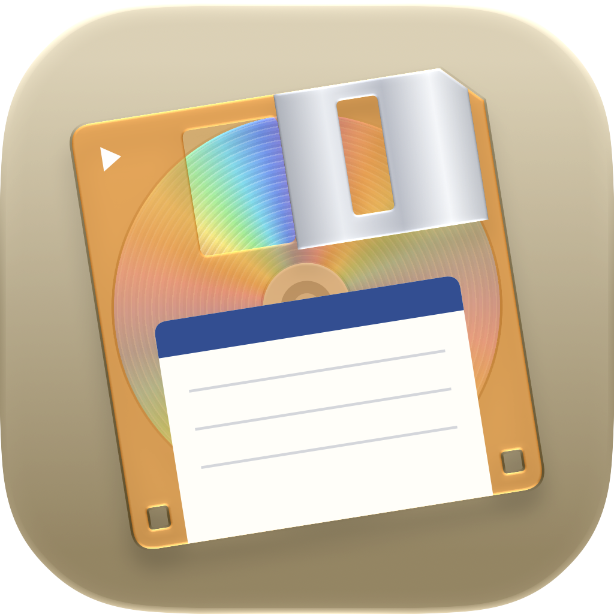

# Silverbox

Welcome to Silverbox!



Silverbox is an emulation front-end for the Mac, built for eXoDOS,
eXoWin3x, eXoWin9x and the other game preservation projects by the eXo team
(https://www.retro-exo.com). It sets up an eXo download without Windows,
reads the collection in place (the LaunchBox XML metadata, box art,
screenshots, manuals, music and videos), and starts each game in a Mac
emulator such as DOSBox Staging, DOSBox-X, 86Box, ScummVM, Spatterlight or
GSplus, with the settings eXo uses on Windows.

The games, media and emulators are not part of this project and must be
obtained separately.

See also:

- [getsilverbox.app](https://getsilverbox.app), the official site.
- [silvercode.studio](https://silvercode.studio), the studio that makes
  Silverbox and [Silverside](https://silverside.app), a CD ripping app for Mac.
- [CHANGELOG.md](CHANGELOG.md), the changes in each version.

## FAQ

### What is this?

Silverbox is an emulator front-end (launcher) for Apple Mac computers that
is designed to allow you to enjoy the [eXo projects](https://www.retro-exo.com)
(retro game collections such as eXoDOS and eXoWin9x) directly on your Mac
without needing a Windows PC.

Silverbox provides an experience on Mac similar to what Windows users get with
LaunchBox: an integrated game and media browser that lets you view game collections,
see game descriptions and details, view images, read game manuals, magazines, and
books, and listen to music and game soundtracks. However, to actually play the games,
you will need to download additional Mac versions of game emulators like DOSBox
that are not provided with Silverbox.

(Note: Silverbox is not affiliated with or endorsed by the eXo Project.)

### What is the eXo project?

eXo is an incredible community project to preserve games and media from the
1980s-1990s era on various systems including MS-DOS / IBM PC, early Windows,
Apple IIgs, and others including the ScummVM (adventure game) project.
They offer various [collections](https://www.retro-exo.com/index2.html)
that you can download that include games, manuals, hint books and other
literature, box art, screenshots, music, and other goodies. eXo's collections
come set up for LaunchBox, a Windows front-end; Silverbox provides
an alternative front-end for Mac users.

See the [eXo FAQ](https://www.retro-exo.com/FAQ.html) for more details.

### What do I need to do to use this?

Silverbox does **not** include the actual eXo project downloads, or any Mac emulators. To get started:

1. Get a BitTorrent client such as
[qBittorrent](https://www.qbittorrent.org/download) or
[Transmission](https://transmissionbt.com/).

2. Visit [retro-exo.com](https://www.retro-exo.com/index2.html)
and grab the torrent file for the eXo collection that you're
interested in. Note: some of these collections, particularly
eXoDOS, are very large and may take a long time to download.
(Tip: see eXoDOS Lite below if you don't want to download 700 GB up front.)

Currently, Silverbox supports the following collections:

   - [eXoDOS](https://www.retro-exo.com/exodos.html) MS-DOS games from
     the 1980s and 1990s.
   - [eXoWin3x](https://www.retro-exo.com/win3x.html) Windows 3.1-era
     games, educational materials and other multimedia.
   - [eXoWin9x](https://www.retro-exo.com/win9x.html) Windows 95/98-era
     games and other multimedia.
   - [eXoIF](https://www.retro-exo.com/if.html) Interactive Fiction (text
     adventures such as Zork)
   - [eXoScummVM](https://www.retro-exo.com/scummvm.html) "Point-and-
     click" adventures that run under the ScummVM game engine, including
     classic Sierra games (King's Quest, etc.)
   - [eXoDemoScene](https://www.retro-exo.com/demoscene.html) primarily
     MS-DOS based "demos" (graphics / multimedia demonstrations)
   - [eXoAppleIIGS](https://www.retro-exo.com/appleIIGS.html) - Apple IIgs
     games and educational software. Most play in GSplus; the 74 games that
     eXo runs in MAME need one ROM file that you supply (see Emulators).
   - (Coming soon) - eXoDREAMM - Loom and similar adventure games

3. Emulators for Mac: All you need to browse the collections are Silverbox
itself and one or more eXo collection downloads. However, to actually play
the games, you will need to download one or more additional emulators for Mac
depending on which titles you want to play.

  See the [Emulators](#emulators) section below for exactly what Mac emulators
  you need to play which titles.

4. Launch Silverbox and drag one of your eXo folders from the Finder to the
app, or click Add Collection… on the welcome screen (or in Settings ›
Library). For a download that is not set up yet, Silverbox asks whether to
unpack the required files inside the download folder, or in a separate local
folder. If you choose the latter, your eXo download is not changed.

### What about eXoDOS Lite?

eXoDOS also comes as "Lite": about 6 GB instead of about 700 GB. It leaves
out the games themselves and downloads each one when you install it.
Silverbox does the same thing, using [aria2](https://aria2.github.io/)
(`brew install aria2`) and the eXoDOS torrent that comes with Lite. The
first download can take a minute or so to find other people sharing the
torrent; after that, downloads start in seconds.

### Can I share eXo files with a Windows install?

Yes, if you download your eXo collections to somewhere that is accessible
to both your Mac and Windows PCs, such as a NAS or other network share,
you can share the installation between both systems. However, don't open
the same folder on multiple PCs at the same time unless the Mac uses a
separate folder for unpacked files.

### Can I use this for other consoles (SNES, etc.)?

Yes, but currently Silverbox depends on an existing LaunchBox
library, and launching these games is experimental. Silverbox does not
find games or fetch their metadata and art itself ("scraping"), and you
cannot add single games by hand yet. However, if you have a LaunchBox
installation from Windows, Silverbox can recognize and use that folder and
take advantage of the metadata, media, etc. already registered by
LaunchBox.

### Who are you?

I am a software engineer with decades of industry experience, who is interested
in classic game and media preservation.

Note: this app was developed with extensive AI coding tool assistance, under
my close supervision and direction.

## Requirements

- macOS 15 or later, on Apple silicon or Intel.
  - Building the app from source needs Xcode 27 or higher.
- One or more eXo downloads, such as eXoDOS v6, eXoWin3x and eXoWin9x.
  Silverbox runs their setup itself, so a Windows PC is not needed; a folder
  set up on Windows works too.
- For eXoDOS Lite, [aria2](https://aria2.github.io/) (`brew install aria2`),
  which downloads each game when you install it.
- The emulators for the packs you play; see [Emulators](#emulators). Most are
  optional: a game whose emulator is missing still shows, with its box art,
  manual and extras.

## Emulators

Silverbox starts games in Mac emulators that you install yourself. Put them
in `/Applications` (or `~/Applications`), or choose them in Settings ›
Emulators. eXo ships Windows builds of the same emulators; the app does not
use them.

Some emulators, including DOSBox-X, aren't notarized by Apple, so the first
time one runs, macOS blocks it and offers to move it to the Trash. Click
Done, then open System Settings › Privacy & Security, scroll down to
Security, and click Open Anyway. Silverbox tells you when an emulator is
blocked like this, and the app's help walks through the steps
(Troubleshooting).

General MIDI music plays through FluidSynth with the eXoDOS Sound Canvas
SoundFont. DOSBox-X and DOSBox Staging 0.83 or later have FluidSynth built in;
for an older DOSBox Staging, install it with `brew install fluid-synth`.

| Collection          | Emulator                                                                                      | What for                                                                                                                                                                                                                                                                            |
| ------------------- | --------------------------------------------------------------------------------------------- | ----------------------------------------------------------------------------------------------------------------------------------------------------------------------------------------------------------------------------------------------------------------------------------- |
| eXoDOS              | [DOSBox Staging](https://www.dosbox-staging.org)                                              | Most games.                                                                                                                                                                                                                                                                         |
| eXoDOS              | [DOSBox-X](https://dosbox-x.com)                                                              | Games that eXo runs in DOSBox-X or SVN Daum, and the Windows 3.x titles. Optional; Staging runs them less faithfully.                                                                                                                                                               |
| eXoWin3x            | DOSBox Staging, DOSBox-X                                                                      | Each game boots its own Windows 3.1. Staging for most; DOSBox-X for the games eXo runs in DOSBox-X or SVN Daum.                                                                                                                                                                     |
| eXoWin9x            | DOSBox-X                                                                                      | Windows 98 for almost every game.                                                                                                                                                                                                                                                   |
| eXoWin9x            | [86Box](https://86box.net)                                                                    | The thirty or so games that eXo runs in 86Box.                                                                                                                                                                                                                                      |
| eXoDemoScene        | DOSBox-X                                                                                      | About 95% of the demos; DOSBox Staging for the rest. The three MartyPC demos (8088 MPH, Area 5150, CGADEMO) are not supported.                                                                                                                                                      |
| eXoScummVM          | [ScummVM](https://www.scummvm.org) 2026.4 or later                                            | Every game. Five games use engines that ScummVM leaves out of its release builds (In Cold Blood, The Adventures of Robin Hood, Star Trek: 25th Anniversary, Lost Eden, Ultima I); set a [daily build](https://buildbot.scummvm.org) as the second ScummVM in Settings to play them. |
| eXoAppleIIGS        | [GSplus](https://github.com/digarok/gsplus) 1.38 or later                                     | Most games, with the Apple IIGS ROM that eXo ships, including the ten that eXo runs in GSport.                                                                                                                                                                                      |
| eXoAppleIIGS        | [MAME](https://www.mamedev.org) (`brew install mame`)                                         | The 74 games eXo runs in MAME. Current MAME needs one ROM file that eXo's set (for MAME 0.245) lacks: `344s0047.bin`, the Apple IIGS character ROM. Add it in Settings › Emulators.                                                                                                 |
| eXoIF               | DOSBox Staging or DOSBox-X                                                                    | The MS-DOS versions of the games.                                                                                                                                                                                                                                                   |
| eXoIF               | [RetroArch](https://www.retroarch.com) cores                                                  | C64 and other Commodores (VICE), ZX Spectrum and ZX81 (Fuse, 81), Apple II (AppleWin), Atari 8-bit (atari800, with eXo's ROMs), Amstrad CPC (cap32), Amiga (PUAE, with a Kickstart ROM you supply).                                                                                 |
| eXoIF               | [Spatterlight](https://ccxvii.net/spatterlight/)                                              | Infocom and other story files that eXo plays in WinFrotz, Lectrote, Gargoyle and similar interpreters. Versions that need Windows programs, MAME or mainframe emulators are not supported.                                                                                          |
| LaunchBox libraries | RetroArch, [Dolphin](https://dolphin-emu.org), MAME or [Mednafen](https://mednafen.github.io) | Console, computer and arcade platforms. Settings › Emulators assigns one per platform, following the library's `Emulators.xml` by default.                                                                                                                                          |

## What plays

With the right Mac emulators installed, nearly every game in the DOS and
Windows packs, the demo scene pack and the ScummVM pack can start. The
exceptions are a few games here and there, some whole computer systems in
eXoIF, and the eXoAppleIIGS games that eXo runs in MAME, until you add one
ROM file. "Can start" means a Mac emulator is known to load the game; not
every game has been played through.

| Pack                 | Games | Can start                                                  | Notes                                                                                                                                                                                                                                                                           |
| -------------------- | ----- | ---------------------------------------------------------- | ------------------------------------------------------------------------------------------------------------------------------------------------------------------------------------------------------------------------------------------------------------------------------- |
| eXoDOS               | 7,667 | Nearly all                                                 | DOSBox Staging or DOSBox-X. A few games show their own version menu inside DOSBox, and a few menu choices need a Windows helper.                                                                                                                                                |
| eXoWin9x (1994–1996) | 665   | All                                                        | Windows 98 in DOSBox-X, about thirty games in 86Box. Network play (Host, Join) is not supported; games start in Solo mode.                                                                                                                                                      |
| eXoWin3x             | 1,139 | Nearly all                                                 | Windows 3.1 in DOSBox Staging or DOSBox-X. Set up and spot-checked: games boot to Windows and start.                                                                                                                                                                            |
| eXoDemoScene         | 2,425 | About 99%                                                  | DOSBox. Not supported: the three MartyPC demos (8088 MPH, Area 5150, CGADEMO). Four demos have no archive in eXo's download either.                                                                                                                                             |
| eXoScummVM           | 832   | About 99% (all with a daily build)                         | Five games need engines that ScummVM's release builds leave out.                                                                                                                                                                                                                |
| eXoIF                | 2,331 | About 64% (about 68% with extra cores and a Kickstart ROM) | Story files in Spatterlight, MS-DOS versions in DOSBox, Commodore, ZX Spectrum, Apple II and Atari 8-bit versions in RetroArch. Not supported yet: BBC Micro, TRS-80, Dragon/CoCo, Oric, TI-99 and other machines, and versions that need MAME, mainframes or Windows programs. |
| eXoAppleIIGS         | 460   | About 84% (all with a ROM file)                            | GSplus, with eXo's settings; a sample of games boot. The 74 games that eXo runs in MAME need the Apple IIGS character ROM, which you supply.                                                                                                                                    |

Many eXoIF games come in versions for several computers, and a game counts
when any of its versions can start. If a version needs a RetroArch core or
ROM that you haven't installed, the launch options tell you which one.

## Where your data goes

Silverbox doesn't change your eXo download unless you ask it to, so the
collection can even live on a read-only drive or network share. Installed
games, save backups, edited configs and caches go in a separate local data
folder: by default `~/Library/Application Support/Silverbox`, and you can
move it to another drive in Settings. Your favorites, play history and
settings always stay on the Mac itself.

If you'd rather have the Windows layout, you can set up a download in place
and install games inside `eXo/eXoDOS`, as eXo does on Windows. eXoDOS Lite
games download into wherever you set the collection up.

When you uninstall a game, Silverbox offers to back up your saved games and
gives them back the next time you install it.

**Updates.** The released app checks for a new version once a day, if you
agree, and installs it with [Sparkle](https://sparkle-project.org). The
check sends Silverbox's and Sparkle's versions only. A copy built from
source does not update itself.

## Build

Open `Silverbox.xcodeproj` and run the "Silverbox" scheme, or use the Makefile:

```
make run                  # build with xcodebuild, then start the app
make run ARGS='-libraryPath /Volumes/eXoDOS_ro -musicEnabled 0'
make build                # build only; CONFIG=Release for a release build
make test                 # core tests (swift test)
make sweep                # translate every eXoDOS config in the mounted library
make format               # reformat the Swift sources with swift-format
make lint                 # report formatting, whitespace and version problems
make install-app          # universal Release build copied to ~/Applications
make open-app             # install-app, then open the app
make reset                # delete the app's settings and local data folder, to test a first start
make site                 # serve the website (docs/site) at http://localhost:8001
make site-shots           # take the website's screenshots again
make dist                 # the signed, notarized disk image (for the maintainer)
```

A release is described in
[docs/internal/Releasing.md](docs/internal/Releasing.md).

The core library (XML parsing, media lookup, config translation, music
decoders) is a Swift package at the repo root, so `swift build` and
`swift test` work without Xcode's project. The app links the package's
`SilverboxCore` product as a local package dependency.

Instructions for coding agents are in `AGENTS.md`. To let Claude Code build
and read diagnostics through the open Xcode, enable MCP under Xcode ›
Settings › Intelligence, then register the server:

```
claude mcp add --transport stdio xcode -- xcrun mcpbridge
```

Xcode asks for permission when a new session connects.

## Third-party code

Two small C libraries are vendored under `Sources/`, each with its license
and a note on its origin:

- [stb_vorbis](https://github.com/nothings/stb) (public domain or MIT) decodes
  Ogg Vorbis menu music.
- [libxmp-lite](https://github.com/libxmp/libxmp) (MIT) plays MOD, S3M, XM and
  IT tracker modules.

macOS plays the other music formats itself.

The app also includes [Sparkle](https://sparkle-project.org) (MIT, plus the
licenses of the code it bundles), which handles updates. Only the app uses
it, not the core library.

The headlines of the About window and the welcome are in
[VT323](https://github.com/phoikoi/VT323), a font by Peter Hull under the
SIL Open Font License 1.1. The file, `Silverbox/Fonts/VT323-Regular.ttf`,
is version 2.000 as Google Fonts ships it; its license is in
`Silverbox/Licenses/VT323.txt`.

## License

Silverbox is free software under the GNU General Public License, version 3
or later; see [LICENSE](LICENSE) and [NOTICE](NOTICE). The name "Silverbox"
and the icon artwork are not covered by it: a modified version that you
distribute needs a different name and icon. The eXo collections are the work
of the eXo team and are not part of Silverbox.

Contributions come in under the MIT License, and ship in Silverbox under the
GPL; see [CONTRIBUTING.md](CONTRIBUTING.md).

## Support Silverbox

Silverbox is free. If you find it useful, you can
[leave a tip](https://silvercode.studio/sponsor?from=silverbox).

## Possible future features

- Couch mode: a full-screen, controller-first view on top of the grid and
  the controller input that exist today, and perhaps a tvOS app built on it.
- An iPhone and iPad companion that browses the library from the Mac.
- Download whole eXo packs from the app; today a BitTorrent client does it.
- Metadata and media scraping for games outside the eXo collections.
- ROM-folder collections: plain `Games/<Platform>` folders with no LaunchBox
  XML beside them, plus single titles configured by hand.
