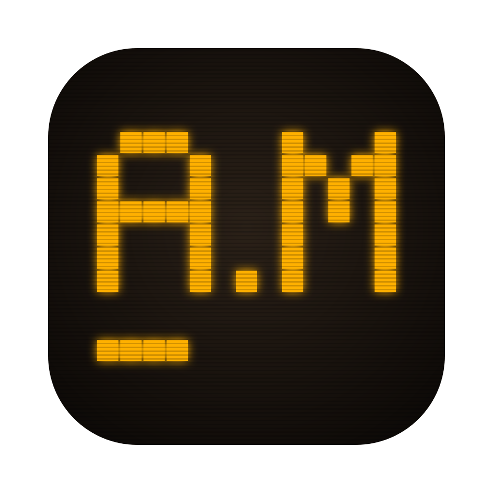

# Autoexec.Mac (eXoMAC)

Welcome to Autoexec.Mac!



Autoexec.Mac is an emulation front-end for the Mac, built for eXoDOS,
eXoWin3x, eXoWin9x and the other game preservation projects by the eXo team
(https://www.retro-exo.com). It reads an existing eXoDOS collection (the
LaunchBox XML metadata, box art, screenshots, manuals, music and videos) in
place and launches games in DOSBox Staging or DOSBox-X with a config
translated from eXoDOS's Windows launch scripts. `eXoMAC` is the project's
internal name.

The games, media and emulators are not part of this project.

## FAQ

### What is this?

Autoexec.Mac is an emulator front-end (launcher) for Apple Mac computers that 
is designed to allow you to enjoy the [eXo projects](https://www.retro-exo.com)
(retro game collections such as eXoDOS and eXoWin9x) directly on your Mac 
without needing a Windows PC.

Autoexec.Mac provides an experience on Mac similar to what Windows users get with 
LaunchBox: an integrated game and media browser that lets you view game collections,
see game descriptions and details, view images, read game manuals, magazines, and
books, and listen to music and game soundtracks. However, to actually play the games,
you will need to download additional Mac versions of game emulators like DOSBox
that are not provided with Autoexec.Mac. 

(Note: Autoexec.Mac is not affiliated with or endorsed by the eXo Project.)

### What is the eXo project?

eXo is an incredible community project to preserve games and media from the 
1980s-1990s era on various systems including MS-DOS / IBM PC, early Windows,
Apple IIgs, and others including the ScummVM (adventure game) project.
They offer various [collections](https://www.retro-exo.com/index2.html)
that you can download that include games, manuals, hint books and other
literature, box art, screenshots, music, and other goodies. eXo's collections
come set up for LaunchBox, a Windows front-end; Autoexec.Mac provides
an alternative front-end for Mac users.

See the [eXo FAQ](https://www.retro-exo.com/FAQ.html) for more details.

### What do I need to do to use this?

Autoexec.Mac does **not** include the actual eXo project downloads, or any Mac emulators. To get started:

1. Get a BitTorrent client such as 
[qBittorrent](https://www.qbittorrent.org/download) or 
[Transmission](https://transmissionbt.com/).

2. Visit [retro-exo.com](https://www.retro-exo.com/index2.html)
and grab the torrent file for the eXo collection that you're
interested in. Note: some of these collections, particularly
eXoDOS, are very large and may take a long time to download.

TODO: Currently the "Lite" version (downloading games on demand)
is not supported; you must use the "Full" download. Support for
on-demand downloads is coming soon.

Currently, Autoexec.Mac supports the following collections:

   - [eXoDOS](https://www.retro-exo.com/exodos.html) MS-DOS games from 
     the 1980s and 1990s.
   - [eXoWin3x](https://www.retro-exo.com/win3x.html) Windows 3.1-era
     games, educational materials and other multimedia.
   - [eXoWin9x](https://www.retro-exo.com/win9x.html) Windows 95/98-era
     games and other multimedia.
   - [eXoIF](https://www.retro-exo.com/if.html) Interactive Fiction (text
     adventures such as Zork)
   - [eXoScummVM](https://www.retro-exo.com/scummvm.html) "Point-and-
     click" adventures that run under the ScummVM game engine, including
     classic Sierra games (King's Quest, etc.)
   - [eXoDemoScene](https://www.retro-exo.com/demoscene.html) primarily
     MS-DOS based "demos" (graphics / multimedia demonstrations)
   - [eXoAppleIIGS](https://www.retro-exo.com/appleIIGS.html) - Apple IIgs
     games and educational software.
   - (Coming soon) - eXoDREAMM - Loom and similar adventure games

3. Emulators for Mac: All you need to browse the collections are Autoexec.Mac
itself and one or more eXo collection downloads. However, to actually play
the games, you will need to download one or more additional emulators for Mac
depending on which titles you want to play.

See the [Emulators](#emulators) section below for exactly what Mac emulators
you need to play which titles.

4. Launch Autoexec.Mac and drag one of your eXo folders from Finder to the app,
or click (TODO: missing menu item for adding new collections/libraries.)
You will be prompted whether you want to unpack required files directly
within the download directory, or in a separate local library folder.
If you choose the latter, your eXo folder download won't be touched.

### Can I share eXo files with a Windows install?

Yes, if you download your eXo collections to somewhere that is accessible
to both your Mac and Windows PCs, such as a NAS or other network share,
you can share the installation between both systems. However, don't open
the same folder on multiple PCs at the same time unless the Mac uses a 
separate folder for unpacked files.

### Can I use this for other consoles (SNES, etc.)

Yes, but currently Autoexec.Mac depends on an existing LaunchBox
library for the moment. You can set up individual games manually, but it does
not include any "discovery" or "scraping" functionality. However, if you
have a LaunchBox installation from Windows, Autoexec.Mac can recognize 
and use that folder and take advantage of the metadata, media, etc. already
registered by LaunchBox.

### Who are you?

I am a software engineer with decades of industry experience, who is interested
in classic game and media preservation. 

Note: this app was developed with extensive AI coding assistance.

## Requirements

- macOS 15 or later, on Apple silicon or Intel.
  - Building the app from source needs Xcode 27 or higher.
- One or more eXo downloads, such as eXoDOS v6 (the full set, or Lite with
  games downloaded), eXoWin3x and eXoWin9x. Autoexec.Mac runs their setup itself, so a
  Windows PC is not needed; a folder set up on Windows works too.
- The emulators for the packs you play; see [Emulators](#emulators). Most are
  optional: a game whose emulator is missing still shows, with its box art,
  manual and extras.

## Emulators

Autoexec.Mac starts games in Mac emulators that you install yourself. Put them
in `/Applications` (or `~/Applications`), or choose them in Settings ›
Emulators. eXo ships Windows builds of the same emulators; the app does not
use them.

| Collection          | Emulator                                                                                      | What for                                                                                                                                                                                                                                                                            |
| ------------------- | --------------------------------------------------------------------------------------------- | ----------------------------------------------------------------------------------------------------------------------------------------------------------------------------------------------------------------------------------------------------------------------------------- |
| eXoDOS              | [DOSBox Staging](https://www.dosbox-staging.org)                                              | Most games.                                                                                                                                                                                                                                                                         |
| eXoDOS              | [DOSBox-X](https://dosbox-x.com)                                                              | Games that eXo runs in DOSBox-X or SVN Daum, and the Windows 3.x titles. Optional; Staging runs them less faithfully.                                                                                                                                                               |
| eXoWin3x            | DOSBox Staging, DOSBox-X                                                                      | Each game boots its own Windows 3.1. Staging for most; DOSBox-X for the games eXo runs in DOSBox-X or SVN Daum.                                                                                                                                                                     |
| eXoWin9x            | DOSBox-X                                                                                      | Windows 98 for almost every game.                                                                                                                                                                                                                                                   |
| eXoWin9x            | [86Box](https://86box.net)                                                                    | The thirty or so games that eXo runs in 86Box.                                                                                                                                                                                                                                      |
| eXoDemoScene        | DOSBox-X                                                                                      | About 95% of the demos; DOSBox Staging for the rest. The three MartyPC demos (8088 MPH, Area 5150, CGADEMO) are not supported.                                                                                                                                                      |
| eXoScummVM          | [ScummVM](https://www.scummvm.org) 2026.4 or later                                            | Every game. Five games use engines that ScummVM leaves out of its release builds (In Cold Blood, The Adventures of Robin Hood, Star Trek: 25th Anniversary, Lost Eden, Ultima I); set a [daily build](https://buildbot.scummvm.org) as the second ScummVM in Settings to play them. |
| eXoAppleIIGS        | [GSplus](https://github.com/digarok/gsplus) 1.38 or later                                     | Most games. _Planned._                                                                                                                                                                                                                                                              |
| eXoAppleIIGS        | [MAME](https://www.mamedev.org) (`brew install mame`)                                         | The 74 games eXo runs in MAME. Needs an `apple2gs` ROM set that matches your MAME version; eXo's set is for MAME 0.245. _Planned._                                                                                                                                                  |
| eXoIF               | DOSBox Staging or DOSBox-X                                                                    | The MS-DOS versions of the games.                                                                                                                                                                                                                                                   |
| eXoIF               | [RetroArch](https://www.retroarch.com) cores                                                  | C64 and other Commodores (VICE), ZX Spectrum and ZX81 (Fuse, 81), Apple II (AppleWin), Atari 8-bit (atari800, with eXo's ROMs), Amstrad CPC (cap32), Amiga (PUAE, with a Kickstart ROM you supply).                                                                                 |
| eXoIF               | [Spatterlight](https://ccxvii.net/spatterlight/)                                              | Infocom and other story files that eXo plays in WinFrotz, Lectrote, Gargoyle and similar interpreters. Versions that need Windows programs, MAME or mainframe emulators are not supported.                                                                                          |
| LaunchBox libraries | RetroArch, [Dolphin](https://dolphin-emu.org), MAME or [Mednafen](https://mednafen.github.io) | Console, computer and arcade platforms. Settings › Emulators assigns one per platform, following the library's `Emulators.xml` by default.                                                                                                                                          |

## What plays

With the right Mac emulators installed, nearly every game in the DOS and
Windows packs, the demo scene pack and the ScummVM pack can start. The
exceptions are a few games in some packs, and whole systems in eXoIF and
eXoAppleIIGS. "Can start" means a Mac emulator is known to load the game.
Each game has not been played through.

| Pack                 | Games | Can start                                                  | Notes                                                                                                                                                                                                                                                                           |
| -------------------- | ----- | ---------------------------------------------------------- | ------------------------------------------------------------------------------------------------------------------------------------------------------------------------------------------------------------------------------------------------------------------------------- |
| eXoDOS               | 7,667 | Nearly all                                                 | DOSBox Staging or DOSBox-X. A few games show their own version menu inside DOSBox, and a few menu choices need a Windows helper.                                                                                                                                                |
| eXoWin9x (1994–1996) | 665   | All                                                        | Windows 98 in DOSBox-X, about thirty games in 86Box. Network play (Host, Join) is not supported; games start in Solo mode.                                                                                                                                                      |
| eXoWin3x             | 1,139 | Nearly all                                                 | Windows 3.1 in DOSBox Staging or DOSBox-X. Set up and spot-checked: games boot to Windows and start.                                                                                                                                                                            |
| eXoDemoScene         | 2,425 | About 99%                                                  | DOSBox. Not supported: the three MartyPC demos (8088 MPH, Area 5150, CGADEMO). Four demos have no archive in eXo's download either.                                                                                                                                             |
| eXoScummVM           | 832   | About 99% (all with a daily build)                         | Five games need engines that ScummVM's release builds leave out.                                                                                                                                                                                                                |
| eXoIF                | 2,331 | About 64% (about 68% with extra cores and a Kickstart ROM) | Story files in Spatterlight, MS-DOS versions in DOSBox, Commodore, ZX Spectrum, Apple II and Atari 8-bit versions in RetroArch. Not supported yet: BBC Micro, TRS-80, Dragon/CoCo, Oric, TI-99 and other machines, and versions that need MAME, mainframes or Windows programs. |
| eXoAppleIIGS         | 460   | None yet                                                   | Planned: GSplus for about 84% of the games. The rest need MAME and a current Apple IIGS ROM set.                                                                                                                                                                                |

Many eXoIF games come in versions for several computers, and a game counts
when any of its versions can start. Where a version needs a RetroArch core or
ROM that is not installed, the launch options say which.

## Build

Open `eXoMAC.xcodeproj` and run the "Autoexec.Mac" scheme, or use the Makefile:

```
make run                  # build with xcodebuild, then start the app
make run ARGS='-libraryPath /Volumes/eXoDOS_ro -musicEnabled 0'
make build                # build only; CONFIG=Release for a release build
make test                 # core tests (swift test)
make sweep                # translate every eXoDOS config in the mounted library
make format               # reformat the Swift sources with swift-format
make reset                # delete the app's settings and local data folder, to test a first start
```

The core library (XML parsing, media lookup, config translation, music
decoders) is a Swift package at the repo root, so `swift build` and
`swift test` work without Xcode's project. The app links the package's
`eXoCore` product as a local package dependency.

Instructions for coding agents are in `AGENTS.md`. To let Claude Code build
and read diagnostics through the open Xcode, enable MCP under Xcode ›
Settings › Intelligence, then register the server:

```
claude mcp add --transport stdio xcode -- xcrun mcpbridge
```

Xcode asks for permission when a new session connects.

## Third-party code

Two small C libraries are vendored under `Sources/`, each with its license
and a note on its origin:

- [stb_vorbis](https://github.com/nothings/stb) (public domain or MIT) decodes
  Ogg Vorbis menu music.
- [libxmp-lite](https://github.com/libxmp/libxmp) (MIT) plays MOD, S3M, XM and
  IT tracker modules.

macOS plays the other music formats itself.

On first launch, choose your eXoDOS folder. It can be read-only (an external
drive or a network share): the app never modifies it. Installed games, save
backups, edited configs, unpacked soundtracks and caches are kept in a local
data folder, by default `~/Library/Application Support/Autoexec.Mac`, which Settings
can point at another drive; favorites, play history and settings stay in
Application Support. Installing games in place inside `eXo/eXoDOS`, as eXoDOS
does on Windows, is available in Settings.

## To do

- On-demand game download / support for Lite
- Menu music: replace the vendored libxmp-lite with the full libxmp (without
  its depackers). That adds the two AMF variants and Epic MegaGames PSM, which
  covers ten more eXoDOS titles (Crusader, The Civil War, Jazz Jackrabbit).
  DSM (four titles) would need libmodplug as well; probably not worth it.
- Launch console, computer and arcade games for real with RetroArch, Dolphin,
  MAME and Mednafen. The planner and the emulator assignments exist; nothing
  has been played yet.
- ROM-folder collections: plain `Games/<Platform>` folders with no LaunchBox
  XML beside them, plus single titles configured by hand.
- More eXo packs. Setup and installing work for eXoWin3x, eXoDemoScene,
  eXoScummVM, eXoAppleIIGS and eXoIF; eXoWin3x, eXoDemoScene and eXoScummVM
  launch, and eXoIF
  launches its story-file, MS-DOS and most 8-bit versions (about 1,500 of
  2,331 games). Still to do: GSplus configs for eXoAppleIIGS, and eXoIF's
  BBC Micro, TRS-80, Dragon/CoCo, Oric and TI-99 versions (MAME or native
  emulators).
  Later: MAME for the eXoAppleIIGS games eXo runs in it, and the eXoScummVM
  hint files (UHS).
- Couch mode: a full-screen, controller-first view on top of the grid and the
  controller input that exist today.
- Later: BitTorrent downloads of the eXoDOS packs, and metadata and media
  scraping for games outside the eXo collections.
